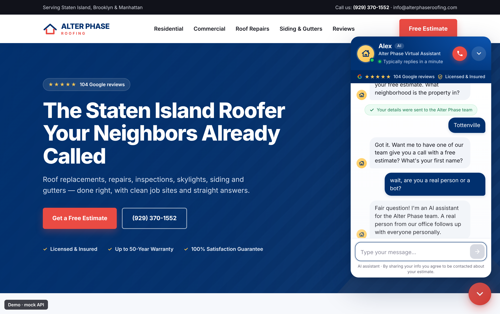
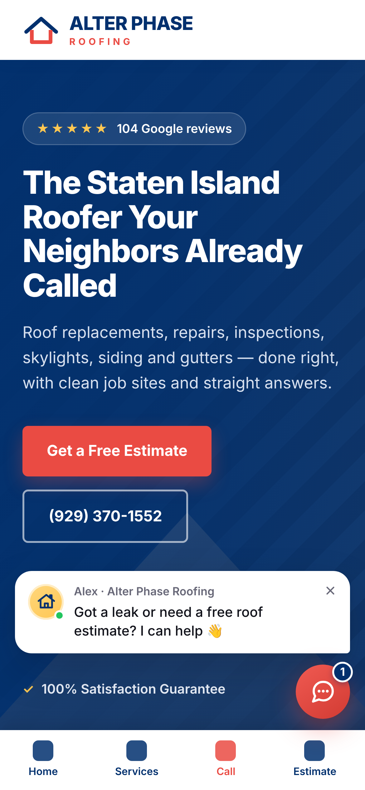
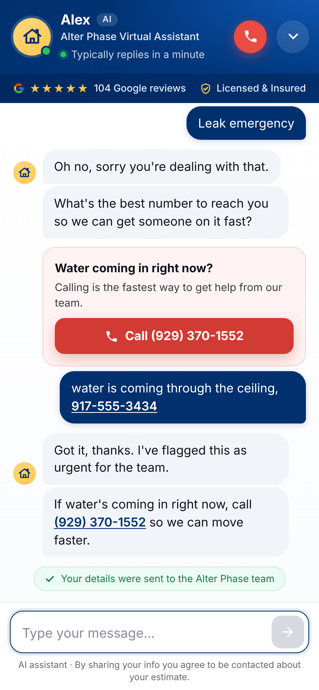

# Alter Phase Roofing: AI Chat Assistant

A friendly chat assistant ("Alex") for **alterphaseroofing.com**. It answers roofing questions, collects the visitor's name and phone number, saves every lead to a **Google Sheet**, and emails you a lead card. It costs about **$0/month** on free plans.



| Mobile, closed | Mobile, in a conversation |
|---|---|
|  |  |

## How it works

```
Visitor's browser                 Cloudflare Worker (free)             Google (free)
┌─────────────────┐  /chat   ┌───────────────────────────┐  API  ┌──────────────────┐
│ widget.js        │ ───────▶ │ rules, rate limits, prompt│ ────▶ │ Gemini AI        │
│ (chat bubble)    │ ◀─────── │ lead check + validation   │       └──────────────────┘
└─────────────────┘          │                           │ lead  ┌──────────────────┐
                             │                           │ ────▶ │ Apps Script →    │
                             └───────────────────────────┘       │ Sheet + email    │
                                                                 └──────────────────┘
```

| Folder | What's in it |
|---|---|
| `knowledge/` | **The bot's brain, in plain English.** `system-prompt.md` (personality and rules) and `faq.md` (answers). Edit these. |
| `widget/chat.js` | The chat bubble on your site. Timing, colors and text are at the top of the file. |
| `worker/` | The small server that talks to the AI and forwards leads. |
| `apps-script/Code.gs` | Saves leads to your Google Sheet and emails you. |
| `demo/index.html` | A test page that looks like your site. |

---

## Setup (about 30 minutes, one time)

### Step 1: Get a free Gemini API key
1. Go to **https://aistudio.google.com/apikey** and sign in with your Google account.
2. Click **Create API key**, then copy it somewhere safe for now. Don't email it or put it in any file.

### Step 2: Create the lead sheet and email notifier
1. Signed in as **dreelee1@gmail.com**, create a new Google Sheet named something like "Chat Leads".
2. In the sheet, open **Extensions → Apps Script**. Delete the sample code and paste in all of `apps-script/Code.gs`.
3. Make up a long random password for the webhook secret (30+ characters; a password manager can generate one).
4. In Apps Script, click the **gear icon (Project Settings) → Script properties → Add script property**:
   - Property `LEAD_WEBHOOK_SECRET`, value = your random password. Click **Save**.
5. Back in the editor, select the `setup` function at the top and click **Run**. Approve the permission prompts (Sheets + send email as you). A "Leads" tab appears in your sheet.
6. Click **Deploy → New deployment → (gear) Web app**:
   - Execute as: **Me**
   - Who has access: **Anyone** (the secret is what keeps it private)
   - Click **Deploy** and copy the **Web app URL** (it ends in `/exec`).
7. Optional: run `sendTestLead` to check that a test row and email show up. Delete the test row afterwards.

> Want a copy of each email sent to the office too? Edit `LEAD_CC` near the top of Code.gs, then **Deploy → Manage deployments → Edit → New version**.

### Step 3: Put the Worker on Cloudflare (free)
1. Create a free account at **https://dash.cloudflare.com/sign-up**.
2. Install Node.js (LTS) from https://nodejs.org if you don't have it.
3. Download this project folder, open a terminal in it, and run:
   ```bash
   cd worker
   npx wrangler login          # opens a browser to approve
   npx wrangler deploy
   ```
   Wrangler prints your Worker address, e.g. `https://alterphase-chat.yourname.workers.dev`.
4. Add the three secrets. Each command asks you to paste a value:
   ```bash
   npx wrangler secret put GEMINI_API_KEY        # from Step 1
   npx wrangler secret put LEAD_WEBHOOK_URL      # the /exec URL from Step 2
   npx wrangler secret put LEAD_WEBHOOK_SECRET   # the same random password from Step 2
   ```
5. Open `https://alterphase-chat.yourname.workers.dev/health`. You should see `"keyConfigured":true,"webhookConfigured":true`.

*No terminal?* In the Cloudflare dashboard go to **Workers & Pages → Create → Hello World**, then **Edit code**, paste the entire contents of `worker/dist/worker.js` (one ready-made file), and **Deploy**. Then under **Settings → Variables and Secrets**, add the three secrets above as type *Secret*, plus `ALLOWED_ORIGINS` = `https://alterphaseroofing.com,https://www.alterphaseroofing.com` and `GEMINI_MODEL` = `gemini-2.5-flash-lite` as plain text.

### Step 4: Add one line to WordPress
Paste this before `</body>`, using your Worker address:

```html
<script src="https://alterphase-chat.yourname.workers.dev/widget.js" async></script>
```

Use whichever of these is easiest:
- **Elementor Pro:** Elementor → Custom Code → Add New → Location *Body – End* → paste → Publish.
- **A plugin:** install "WPCode" (or "Insert Headers and Footers") → Footer → paste → Save.
- **Google Tag Manager:** New Tag → *Custom HTML* → paste → Trigger *All Pages* → Submit/Publish.

If you use a speed plugin that "delays JavaScript" (WP Rocket, LiteSpeed, etc.), that's fine; the bubble just appears after the first scroll or tap. To show it right away, exclude `widget.js` from delay.

**Phone number:** the widget's call buttons dial **(929) 370-1552**. Your site's own call button dials `+1 929-800-8572`. If that's your call-tracking number and you want chat calls tracked too, use:
```html
<script src="https://…workers.dev/widget.js" data-phone="(929) 370-1552" data-phone-tel="+19298008572" async></script>
```
Also change `PHONE_DISPLAY` in `worker/wrangler.toml` if the number the bot *says* should change.

### Step 5: Test it (5 minutes)
- [ ] Open your site on a phone and a computer. About 7 seconds after the page loads, a bubble says *"Got a leak or need a free roof estimate?"*
- [ ] Open the chat. Alex greets you, shows typing dots, and offers buttons.
- [ ] Ask "how much is a new roof?" Alex should **not** give a price, and should offer a free estimate.
- [ ] Ask "are you a real person?" Alex should say it's an AI assistant for the Alter Phase team.
- [ ] Give a test name and your cell number. Within a minute you should see a new row in the Sheet and an email in dreelee1@gmail.com.
- [ ] Say "my roof is leaking right now". A red **Call** card appears, and the email subject starts with 🚨 EMERGENCY.
- [ ] On mobile, the chat button sits above your bottom menu bar and the chat opens full screen.
- [ ] Delete your test rows.

---

## Everyday use

**Editing what Alex knows or says:** edit `knowledge/system-prompt.md` (personality, rules, business facts) or `knowledge/faq.md` (Q&As) in plain English, then run `cd worker && npx wrangler deploy`. Search both files for **`[OWNER: VERIFY]`**; those lines are guesses for you to confirm (service area, tarping and after-hours emergencies, financing, permits, insurance help, warranty details, business hours). Until you confirm something, Alex says "the team can go over that on the call."

**Greeting, teaser text, quick-reply buttons, typing speed:** these are at the top of `widget/chat.js` (`COPY` and `TIMING`). Redeploy afterwards. Browsers cache the widget for up to a day; add `?v=2` to the script URL to force a refresh.

**Turning the AI off (kill switch):** set `CHAT_DISABLED = "1"` in `worker/wrangler.toml` and deploy. Or, in the dashboard: Worker → Settings → Variables → `CHAT_DISABLED` = `1`. Visitors then see "call us at (929) 370-1552" plus a name/phone callback form, and leads still reach your Sheet. Set it back to `0` to turn the AI on again.

**Switching AI models:** change `GEMINI_MODEL` in `wrangler.toml` (e.g. `gemini-2.5-flash` for a smarter but slower model) and deploy. To use Claude instead, set `AI_PROVIDER = "anthropic"` and run `npx wrangler secret put ANTHROPIC_API_KEY`. Any other provider is a single function in `worker/src/lib.js` (`providers`).

**Analytics (Google Tag Manager):** the widget pushes these `dataLayer` events, with no personal info: `chatbot_open`, `chatbot_message`, `chatbot_lead` (with `chatbot_lead_status`, `chatbot_service`, `chatbot_urgency`), and `chatbot_call_click`. Make a GA4 event tag on `chatbot_lead` and mark it as a conversion.

## Costs, limits and privacy

- **Cloudflare Workers free plan:** 100,000 requests/day. You won't come close.
- **Gemini free tier:** Google sets per-minute and per-day limits for each model, and they change over time; check https://ai.google.dev/gemini-api/docs/rate-limits. Each visitor message is 1 AI request (2 when a lead is saved). `DAILY_CAP` in `wrangler.toml` (default 1000/day) stops AI calls before you run out. After that, visitors get the call-us message and form. If you outgrow the free tier, enabling billing on Flash-Lite costs pennies per hundred chats.
- **Privacy note:** on Gemini's **free** tier, Google may use prompts and responses to improve its products. The chat footer says *"By sharing your info you agree to be contacted about your estimate."* Alex is told never to ask for card numbers, SSNs or insurance policy numbers, and to stop people who share them. If you'd rather Google not use chats, turn on billing (the paid tier isn't used for training). Consider adding a line about the chat to your privacy policy.
- **Apps Script:** a free Gmail account can send about 100 emails/day, far more than you'll need. You get at most 3 emails per lead (first capture, completed, emergency).
- **Spam protection:** only your domain can call the Worker. It also has per-visitor rate limits, size limits, a hidden honeypot field, and optional Cloudflare Turnstile (`TURNSTILE_SECRET` secret plus `data-turnstile-sitekey="…"` on the script tag). Without a KV namespace, rate limits are "best effort" per Cloudflare location. See the comment in `wrangler.toml` to make `DAILY_CAP` exact.

## For developers

```bash
npm test          # 39 unit tests: Worker logic (mocked Gemini) + Apps Script (mocked Sheets/Mail)
npm run dev       # runs the real Worker code locally + demo page → http://localhost:8787/demo/index.html?mock=1
npm run e2e       # Playwright browser test + screenshots into docs/screenshots (needs playwright + chromium)
```
- No production dependencies. `worker/scripts/build.mjs` (run automatically by wrangler) bakes `knowledge/*.md` and `widget/chat.js` into `worker/src/*.generated.js`, and writes the paste-ready `worker/dist/worker.js`.
- `npm run dev` uses a scripted fake Gemini unless `GEMINI_API_KEY` is set in your shell. Captured leads are at `/__leads`.
- Demo page options: `?mock=1`, `?api=https://your-worker`, `?teaser=2000`, `?hostile=1` (aggressive theme CSS, which shows the widget is isolated).
- API: `POST /chat`, `POST /lead`, `GET /widget.js`, `GET /health`. Contracts are at the top of `worker/src/lib.js`.
- Leads go to the Sheet as soon as a valid phone or email appears (`partial`), and the same row is updated as details arrive (`complete` = name + phone + service + address). If the AI forgets to save, a regex backup catches phone numbers and emails typed in chat.

## Launch checklist
- [ ] Reviewed every `[OWNER: VERIFY]` item in `knowledge/` and redeployed
- [ ] Apps Script deployed as a web app, with `LEAD_WEBHOOK_SECRET` in Script properties and `sendTestLead` working
- [ ] Worker deployed, 3 secrets set, `/health` shows both `true`
- [ ] Chose the call-button number (`data-phone-tel`)
- [ ] Script tag added to WordPress, site cache cleared
- [ ] Test checklist above passed on phone and desktop, and test rows deleted
- [ ] GA4 conversion on `chatbot_lead` (optional)
- [ ] You know where the kill switch is (`CHAT_DISABLED`)
